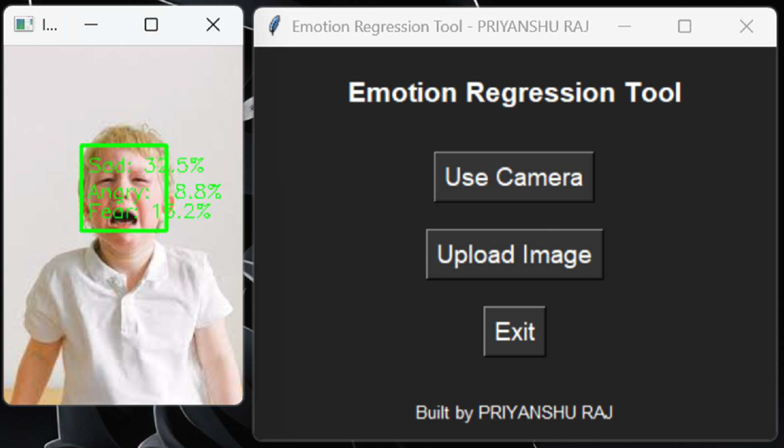

# Real-Time Facial Emotion Intensity Estimation

A deep learning-based regression system that transitions from discrete emotion classification to continuous emotional intensity estimation. Built as a production-ready desktop application with a real-time Tkinter GUI.



### Key Features
* **Regression Modeling:** Outputs percentage-based intensities for 7 emotions (Angry, Disgust, Fear, Happy, Sad, Surprise, Neutral) rather than rigid single-class labels.
* **Hardware Optimization:** Benchmarked to show 8-10x faster training epochs using NVIDIA RTX 3060 Ti via CUDA 12.3 and cuDNN 8.9.
* **Real-Time Desktop UI:** Integrated with OpenCV for live webcam feeds, featuring dynamic matplotlib pie charts, FPS tracking, and mood logging.
* **Alert System:** Triggers an audio alert and visual warning if negative emotions (Anger/Sadness) exceed the 70% intensity threshold.

### Tech Stack
* **Deep Learning:** TensorFlow 2.19.0, Keras API
* **Computer Vision:** OpenCV (Haar Cascades for face detection)
* **Application & Deployment:** Python 3.10.16, Tkinter, Matplotlib, PyInstaller, Inno Setup
* **Dataset:** Trained and evaluated using the FER2013 dataset.

### Prerequisites
* Python 3.10+
* A working webcam for real-time inference.

### How to Run
1. Clone the repository:
   ```bash
   git clone [https://github.com/yourusername/emotion-intensity-estimation.git](https://github.com/yourusername/emotion-intensity-estimation.git)
   cd emotion-intensity-estimation
   ```
2. Install dependencies: 
   ```bash
   pip install -r requirements.txt
   ```
3. Run the application: 
   ```bash
   python src/app.py
   ```

### Documentation
For a detailed breakdown of the model architecture, CNN layer configurations, and CPU vs. GPU benchmarking, please refer to the [Project Report](docs/Priyanhu's%20Final%20Internship%20Report_1.pdf) located in the `docs/` folder.

---
**Author:** Priyanshu Raj  
